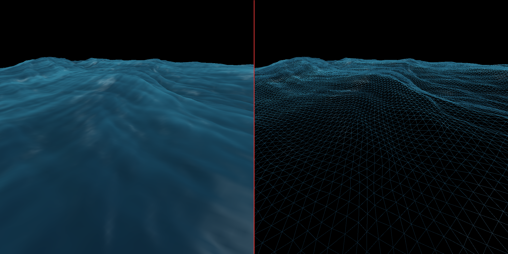

# Ocean surface simulation with OpenCL and Vulkan interoperability



## Sample Purpose

This sample demonstrates how to share compute/render resources between OpenCL and Vulkan to simulate an ocean surface. It uses the same OpenCL kernels as the OpenGL ocean sample in the parent folder. If the device supports the cl_khr_external_memory extension and Vulkan runs on the same device as OpenCL, the OpenCL images used for rendering are created from Vulkan memory, exported with vkGetMemoryFdKHR on Linux or vkGetMemoryWin32HandleKHR on Windows. Otherwise, or if external memory is turned off on the command line, the OpenCL images are copied to the Vulkan images every frame.

## Key APIs and Concepts

The primary focus of this sample is to understand how to set up shared resources between OpenCL and Vulkan interoperability. Additionally, this sample demonstrates how to approach physical, real-time simulations in OpenCL and the API objects involved in executing an OpenCL application such as ocean surface simulation.


### Application flow

The application performs an initial setup during which:

- An OpenCL device is selected based on CLI options, and Vulkan picks the physical device with the same UUID (cl_khr_device_uuid), if there is one.
- OpenCL and Vulkan devices are prepared.
- A SFML window, camera, and related keyboard event callbacks are created.
- Both shared and private resources for OpenCL and Vulkan are set up.

Available CLI options are as follows:

- `-p`, `-d`, `-t`: index of the platform, index of the device, and device type to use for OpenCL
- `-x`, `-y`: window width and height
- `--vulkan_device <index>`: Vulkan physical device to use (default: the one OpenCL runs on)
- `--immediate <0|1>`: prefer VK_PRESENT_MODE_IMMEDIATE_KHR, no vsync (default: 0)
- `--linear <0|1>`: use linearly tiled images (default: 0)
- `--deviceLocalImages <0|1>`: use device local images (default: 1)
- `--useExternalMemory <0|1>`: use cl_khr_external_memory when possible (default: 1)
- `--validationLayersOn <0|1>`: enable the Vulkan validation layers (default: 0)

After the setup, the simulation starts with initial ocean parameters that can be modified with keyboard events in real-time:

- a/z - Increase/decrease wind magnitude.
- s/x - Change wind heading.
- d/c - Increase/decrease waving amplitude.
- f/v - Increase/decrease wave choppiness.
- g/b - Increase/decrease additional altitude scale.

Additionally, the simulation and rendering can be paused with the Space key. Rendering can toggle between wireframe and filled modes using the 'w' key. Application tracks its performance in the title bar of the window, it could be toggled by pressing 'e' key.

While the simulation is in progress, each frame of the application performs the following general steps:

- Vulkan waits until the previous use of the frame's resources is complete.
- Uniform buffers are updated to handle camera and ocean parameters.
- OpenCL kernels are enqueued, and OpenCL finishes before Vulkan uses the images.
- The ocean grid is rendered using the previous OpenCL computation outcome.


### Kernel logic

Multiple kernels follow the general steps (with multiple optimizations) described in the publication:  [Realtime GPGPU FFT ocean water simulation](https://tore.tuhh.de/bitstream/11420/1439/1/GPGPU_FFT_Ocean_Simulation.pdf)

### Used API surface

```c++
cl::util::supports_extension(cl::Device, cl::string)
cl::util::read_exe_relative_text_file(const char*, cl_int* const)
cl::util::read_exe_relative_binary_file(const char*, cl_int* const)
cl::Context(cl::Device)
cl::CommandQueue(cl::Context, cl::Device)
cl::Platform::get(vector<Platform>)
cl::Platform::getDevices(Type, vector<Device>)
cl::Program::build()
cl::Image2D(cl::Context, cl_mem_flags, ImageFormat, size_type, size_type)
cl::Error::what()
cl::Error::err()
cl::NDRange(size_type, size_type)
cl::Buffer::Buffer(cl::Context, cl_mem_flags, size_type)
cl::CommandQueue::enqueueAcquireExternalMemObjects(const vector<cl::Memory>&)
cl::CommandQueue::enqueueReleaseExternalMemObjects(const vector<cl::Memory>&)
clCreateImageWithProperties(cl_context, const cl_mem_properties*, cl_mem_flags, const cl_image_format*, const cl_image_desc*, void*, cl_int*)
clGetDeviceInfo(CL_DEVICE_UUID_KHR)
```
